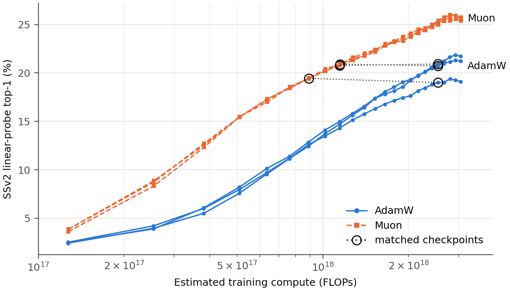
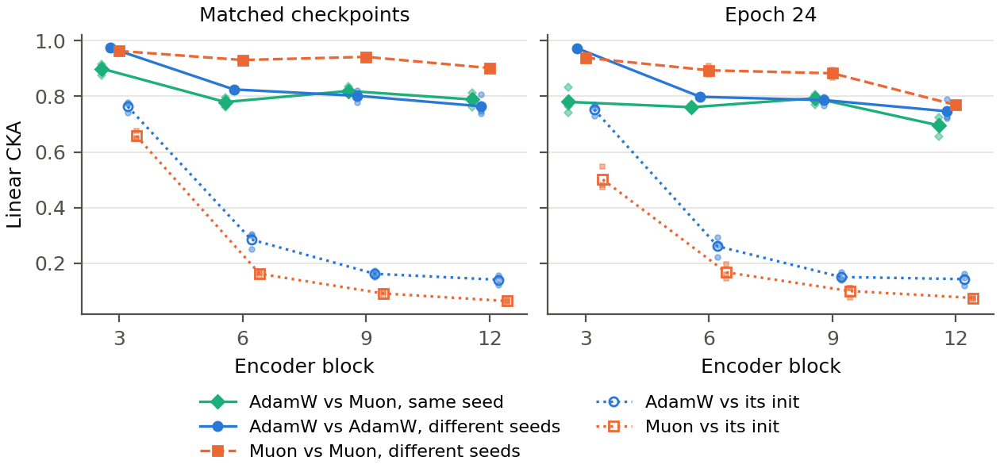
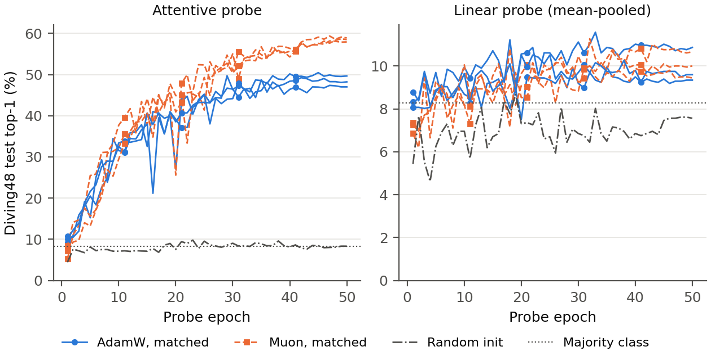

# ToyJEPA

AdamW vs. Muon for V-JEPA-style self-supervised video pretraining.

The thesis pretrains the same model on Something-Something-v2 and ImageNet-1k with each optimizer, in pairs of runs that share initial weights and data order. It measures how much compute each optimizer needs to reach the same frozen-encoder linear-probe accuracy on SSv2, how similar the learned representations are (CKA), and whether checkpoints with matched SSv2 accuracy transfer differently to Diving48.

Some differences from V-JEPA 2.1: every block has QK-norm, a per-head sigmoid gate on the attention output and a LayerNorm on each attention and MLP output. These stabilize training, especially using Muon.

# Results

*SSv2 linear-probe top-1 against estimated training compute (log scale) for three
seed pairs, probed after every epoch. Circles mark the matched checkpoints: AdamW at its last
stable-LR epoch (20) and the Muon checkpoint with the closest probe accuracy (epochs 7, 9 and 9),
joined by dotted lines. Muon reaches the same accuracy with 2.41× fewer FLOPs.*


*Linear CKA between the mean-pooled features of the frozen teacher encoders at each
hierarchical level (encoder blocks 3, 6, 9 and 12) on the SSv2 test split, for the matched
checkpoints (left) and after 24 epochs (right). Lines are means over three pairs, small markers
single pairs. AdamW and Muon are less similar to each other than two runs of the same optimizer
with different seeds, mainly in the early blocks, and Muon moves further from its initialization
than AdamW.*


*Diving48 test top-1 over 50 probe epochs for the frozen encoders at the
matched checkpoints, with an attentive probe (left) and a mean-pooled
linear probe (right, on its own y-scale). Dash-dotted: the random initialization of the seed-3
pair. Dotted: always predicting the most frequent class (8.3%). With the attentive probe, Muon
ends 10.1 pp ahead. With the linear probe, both optimizers stay near the majority-class level.*

## Environment

The project uses [uv](https://docs.astral.sh/uv/). The environment was set up for an RTX5090.

```bash
curl -LsSf https://astral.sh/uv/install.sh | sh   # only if uv is not installed
uv sync
uv run wandb login                                 # training logs to the W&B project `toyjepa`
```

Run Python through `uv run`, e.g. `uv run python -m toyjepa.train`. Set `WANDB_MODE=offline` to train without logging to W&B.


## Data

The datasets are not included; each is subject to its own license and terms of use.

Datasets live in `data/` at the repository root (`data/` can be a symlink). The `manifests/` folders are created on the first run. Take care that the directory tree looks like described below.

```text
data/
├── something-something-v2/
│   ├── labels/
│   │   ├── labels.json
│   │   ├── train.json
│   │   └── validation.json
│   ├── videos/
│   │   └── 20bn-something-something-v2/   # <id>.webm
│   └── manifests/
├── ILSVRC/
│   ├── LOC_synset_mapping.txt
│   ├── Data/
│   │   └── CLS-LOC/
│   │       ├── train/                     # <synset>/*.JPEG
│   │       └── val/                       # *.JPEG
│   ├── Annotations/
│   │   └── CLS-LOC/
│   │       ├── train/                     # <synset>/*.xml
│   │       └── val/                       # *.xml
│   └── manifests/
└── diving48/
    ├── Diving48_train.json
    ├── Diving48_test.json
    ├── Diving48_vocab.json
    └── Diving48/
        └── rgb/                           # <vid_name>.mp4
```

**ImageNet-1k.** Download the [ImageNet Object Localization Challenge](https://www.kaggle.com/c/imagenet-object-localization-challenge) data from Kaggle.

**Something-Something-v2.** Download the [SSv2](https://www.qualcomm.com/developer/software/something-something-v-2-dataset) data from qualcomm.

**Diving48.** Download the [Diving48](http://www.svcl.ucsd.edu/projects/resound/dataset.html) data from UCSD website.

## Training run sweep for Adamw and Muon

```bash
uv run python -m toyjepa.train --multirun \
  optim.name=muon,adamw \
  trainer.seed=1 \
  'trainer.run_name="thesis-peri-${optim.name}-lr${optim.lr}-s${trainer.seed}"'
```

## Acknowledgements

Small parts of `toyjepa/models/encoder.py` and `toyjepa/models/predictor.py` are adapted from [V-JEPA 2](https://github.com/facebookresearch/vjepa2). The attentive probe toyvjepa/models/probes.py, and CrossAttention and CrossAttentionBlock in toyvjepa/models/transformer.py match V-JEPA 2.1 attentive classifier, with QK-norm added.
